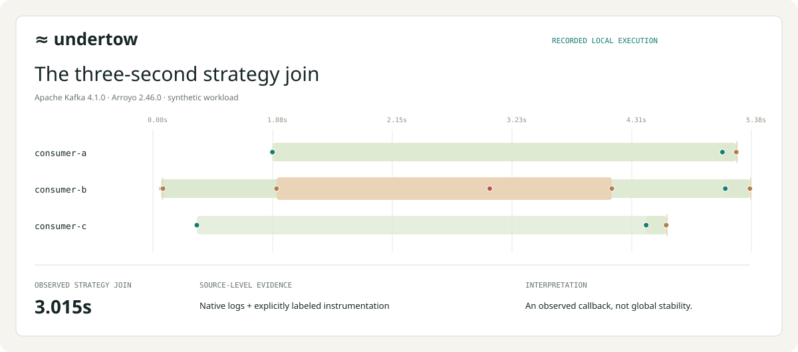

# ≈ Undertow

**Investigate Sentry Arroyo consumer incidents from one timeline.**

Undertow combines logs from multiple Arroyo workers so an on-call engineer can see when partitions moved, which worker was draining its processing strategy, and what the capture cannot establish. Inspect the original log message and source line behind a timeline event, compare two captures, or export a portable incident report.

**[Open the recorded investigation](https://balkashynov.github.io/undertow/#workbench)** · [Run on your logs](#run-locally) · [Measured evidence](docs/VALIDATION.md) · [Release](https://github.com/balkashynov/undertow/releases/tag/v0.1.0)

[](https://github.com/balkashynov/undertow/actions/workflows/ci.yml)

> **The example:** a real Arroyo worker takes **3.015 seconds** to join its processing strategy during a rebalance. Undertow identifies `consumer-b`, shows the surrounding partition transitions, and points to the native log lines behind the duration. The workload is synthetic; the Kafka broker, workers and captured logs are real.

[](https://balkashynov.github.io/undertow/#workbench)

## Try the investigation in one minute

No install, account or Kafka cluster needed. The [browser workbench](https://balkashynov.github.io/undertow/#workbench) opens **01 · The slow strategy join**.

1. Select the **STRATEGY DRAIN** finding showing **3.015s**. The inspector opens `consumer-b.jsonl:93`, the native `Waiting for ... to exit` message.
2. Open **Compare captures** and select **02 · Healthy rebalance**. Compare the observed revocation duration with the delayed capture.
3. Select **05 · Native logs only**, then **Timeline**. Processing and successful broker-commit timing become **unknown** because that evidence is absent.

The demo is a viewer over saved executions. It does not start a broker or replay a live incident. [Longer walkthrough and CLI usage](docs/USAGE.md).

## When would you use it?

Use Undertow when investigating a consumer restart, deployment or rebalance and the evidence is spread across worker logs:

| Investigation question | What Undertow provides |
| --- | --- |
| Which worker spent time joining its strategy during revocation? | Measured callback/strategy intervals, the worker identity and the underlying log lines. |
| Where did a partition move, including a partial cooperative rebalance? | Per-partition assignment epochs alongside consumer lifecycle events. |
| Did processing or commits resume, or are those observations missing? | Explicitly labeled progress signals; missing evidence stays unknown. |
| How can another engineer inspect the same incident? | An exported JSON bundle, pseudonymized case, Mermaid sequence or self-contained HTML report. |

The project addresses the log-timeline workflow described in [Sentry Arroyo #461](https://github.com/getsentry/arroyo/issues/461). It works with exported evidence alongside existing metrics and log search. It does not require a change to the running consumer or access to a production Kafka cluster. Optional instrumentation adds processing and confirmed-commit observations that native logs do not supply.

## What is implemented

| Component | Working capability | Code / contract |
| --- | --- | --- |
| Parser and analyzer | GCP LogEntry arrays, JSONL and documented plain logs; bounded parsing, source references, partial revocations and incomplete-capture handling. | [Python core](src/undertow/core.py), [input contract](docs/CONTRACT.md) |
| Interactive workbench | Consumer timeline, partition handoffs, evidence search and inspection, capture comparison, seven recorded/control cases. | [Browser UI](src/undertow/web/app.js), [analysis engine](src/undertow/web/engine.js) |
| Local app and CLI | Raw-log import, persistent incident library, analysis, comparison and portable exports. Python 3.11+, zero third-party runtime dependencies. | [Server](src/undertow/server.py), [CLI](src/undertow/cli.py) |
| Reproducible lab and checks | Real Kafka/Arroyo experiments, independent broker-offset checks, parser/server tests and Python/JavaScript analysis parity. | [Lab](scripts/lab.py), [tests](tests), [validation](docs/VALIDATION.md) |

The hosted viewer accepts **Undertow JSON bundles**. Raw-log parsing, persistent storage and standalone HTML export run in the local app or CLI. Imported bundles are validated and their analysis is recomputed.

## Evidence you can inspect

The recorded lab uses **Apache Kafka 4.1.0 and Arroyo 2.46.0**, with six partitions and 96 message IDs per scenario.

| Experiment or control | Recorded result |
| --- | --- |
| Healthy vs delayed strategy join | Longest join **0.015s vs 3.015s**. The delayed case injected a 3,000 ms sleep; an independent monotonic measurement recorded 3,004.225 ms. |
| Healthy, delayed, crash/replacement and auto-commit runs | Each processed all 96 IDs; independently queried final broker next offsets were 16 on all six partitions. |
| Native logs without progress instrumentation | First processing and confirmed-commit timing remain unknown. A commit-path DEBUG message is not proof of a broker commit. |
| Capture truncated before the join completes | The callback remains incomplete; the analyzer does not invent a completion or diagnose a permanent stall. |

[Raw logs and complete results](docs/evidence/lab-final) · [27 automated checks and validation limits](docs/VALIDATION.md) · [Current CI](https://github.com/balkashynov/undertow/actions/workflows/ci.yml)

These are small local experiments with synthetic workloads. They establish the reported observations, not production loss rates or exactly-once guarantees. The separate 64-consumer navigation case is generated, not a 64-worker Kafka run.

## Run locally

```bash
git clone https://github.com/balkashynov/undertow
cd undertow
python3 -m venv .venv
.venv/bin/pip install -e .
.venv/bin/undertow serve
```

Open **http://127.0.0.1:8767/** and choose **Import capture**. Bring logs with explicit consumer identity and timestamps, or explore the included cases. Docker is only needed to rerun the lab.

The server listens on loopback and keeps imported cases in `.undertow/cases/`. There is no upload service or telemetry. Use `--data-dir /path/to/cases` for a different library location. [Input formats, identity rules and CLI examples](docs/USAGE.md) · [Security and export privacy](SECURITY.md).

You can also turn the checked-in raw logs into a report without starting the app:

```bash
.venv/bin/undertow analyze docs/evidence/lab-final/slow-drain/consumer-*.jsonl \
  --title "Recorded slow strategy join" \
  -o /tmp/undertow-incident.json --html /tmp/undertow-incident.html
```

The HTML contains the viewer and evidence in one file. To share a pseudonymized version, use `.venv/bin/undertow export /tmp/undertow-incident.json --redact --format html -o /tmp/undertow-shareable.html`. Review the output: relative timing, offsets and topology counts remain.

## Engineering boundaries

- **Known log patterns:** native parsing is pinned to Arroyo 2.46.0. Other timestamped messages remain visible as notes. GCP parsing is format-tested; a production cloud export has not been validated.
- **Evidence, not inferred health:** assignment does not prove processing, silence does not prove a stall, and a local callback does not prove group-wide stability. Cross-worker alignment assumes synchronized clocks.
- **Independent implementation:** a standalone local viewer or reusable parser/fixture set is the intended integration path. [Runtime logging](https://github.com/getsentry/arroyo/pull/439), [rebalance tests](https://github.com/getsentry/arroyo/pull/411) and [Rust runtime work](https://github.com/getsentry/arroyo/pull/560) are related upstream efforts. This project has not been adopted by Sentry.

The next useful evaluation is a representative sanitized incident: does the timeline answer the on-call question, and which missing observations would make it trustworthy? [Full analysis contract](docs/CONTRACT.md).

## Reproduce and develop

```bash
.venv/bin/pip install -e '.[dev]'
.venv/bin/python -m pytest -q   # Node.js required for browser-engine parity

# Optional: rerun the real lab with Docker running.
.venv/bin/pip install -e '.[lab]'
.venv/bin/python scripts/lab.py --output /tmp/undertow-lab
```

The lab creates a disposable, loopback-published broker and removes it on completion or failure. [Experiment details](docs/VALIDATION.md) · [Contributing](CONTRIBUTING.md).

Built by Ivan Balkashynov. Independent project, unaffiliated with Sentry. [Apache-2.0](LICENSE).
